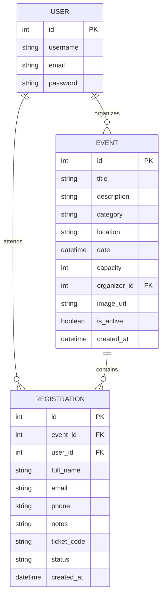

# CodeAlpha Backend Development Internship
## 🎯 TASK 2: Event Registration System

[](https://python.org)
[](https://djangoproject.com)
[](https://www.django-rest-framework.org)
[]()
[]()

A robust, enterprise-grade **Event Registration & Management Backend System** built with **Django** and **Django REST Framework (DRF)**.

This system provides full RESTful APIs and a responsive interactive web interface for creating events, browsing upcoming events, reserving tickets, real-time capacity and duplicate registration handling, ticket management/cancellation, and an organizer/administrator portal.

---

## 🌟 Key Features

1. **Event Management:**
   - Create, list, retrieve, update, and manage events.
   - Filter by categories (*Technology, Workshop, Seminar, Hackathon, Networking*).
   - Full-text search by title, description, or venue location.
   - Real-time seat capacity tracking (`registered_count`, `available_seats`, `is_full`).

2. **Registration & Ticket Reservation:**
   - Reserve seats with instant unique ticket codes (e.g. `EVT-4A7B2C1D`).
   - Guest registration (via email) or authenticated user registration.
   - **Concurrency & Overbooking Protection**: Rejects bookings once capacity is reached.
   - **Duplicate Prevention**: Prevents the same email from registering multiple times for the same event.

3. **Attendee Self-Management (View & Cancel):**
   - Attendee dashboard to view all active and past bookings.
   - One-click cancellation with immediate seat release and ticket status update.
   - Printable ticket receipts.

4. **Organizer & Administrator Dashboard (Django Admin):**
   - Manage events and registrations.
   - Inline attendees overview inside each event.
   - Quick bulk actions (*Mark Confirmed*, *Mark Cancelled*).

5. **Complete RESTful API & Interactive Explorer:**
   - Clean JSON endpoints with standard HTTP status codes.
   - Built-in API documentation page (`/docs/`).

---

## 🏛️ Database Models



---

## 📡 REST API Reference

| Method | Endpoint | Description | Auth Required |
|---|---|---|---|
| `GET` | `/api/events/` | List all active events (`?search=...`, `?category=...`) | Public |
| `GET` | `/api/events/<id>/` | Get detailed event info & remaining seats | Public |
| `POST` | `/api/events/` | Create a new event | Organizer / Admin |
| `PUT/DELETE`| `/api/events/<id>/` | Update or delete an event | Organizer / Admin |
| `POST` | `/api/events/<id>/register/` | Submit event registration | Public |
| `GET` | `/api/events/<id>/attendees/`| View attendee list for event | Organizer / Admin |
| `GET` | `/api/my-registrations/` | List registrations (`?email=...` or user session) | Public / User |
| `POST` | `/api/registrations/<id>/cancel/` | Cancel registration & free seat | Public / Attendee |
| `POST` | `/api/auth/register/` | Register new user account | Public |
| `POST` | `/api/auth/login/` | User login session | Public |
| `POST` | `/api/auth/logout/` | User logout | Authenticated |
| `GET` | `/api/auth/me/` | Current user profile | Authenticated |

---

## 🚀 Quick Setup & Installation

### 1. Clone repository
```bash
git clone https://github.com/YOUR_USERNAME/CodeAlpha_EventRegistrationSystem.git
cd CodeAlpha_EventRegistrationSystem
```

### 2. Activate Virtual Environment
- **Windows (PowerShell):**
  ```powershell
  .\venv\Scripts\Activate.ps1
  ```
- **Linux / macOS:**
  ```bash
  source venv/bin/activate
  ```

### 3. Install Dependencies
```bash
pip install -r requirements.txt
```

### 4. Apply Database Migrations
```bash
python manage.py migrate
```

### 5. Seed Pre-configured Demo Data
Automatically creates events, sample attendees, admin, and test user:
```bash
python manage.py seed_data
```

### 6. Run the Development Server
```bash
python manage.py runserver
```

Now open:
- 🌐 **Web Portal**: [http://127.0.0.1:8000/](http://127.0.0.1:8000/)
- 📖 **Interactive API Docs**: [http://127.0.0.1:8000/docs/](http://127.0.0.1:8000/docs/)
- ⚙️ **Django Admin**: [http://127.0.0.1:8000/admin/](http://127.0.0.1:8000/admin/)

---

## 🔑 Default Credentials

| Role | Username | Password | Email |
|---|---|---|---|
| **Superuser / Admin** | `admin` | `admin123` | `admin@codealpha.tech` |
| **Demo Attendee** | `john_doe` | `password123` | `john.doe@example.com` |

---

## 🧪 Running Automated Tests

Run the test suite verifying all 10 unit and API integration test cases:
```bash
python manage.py test
```

---

## 👨‍💻 Developed For
**CodeAlpha Internship Program** — *Backend Development Domain*
